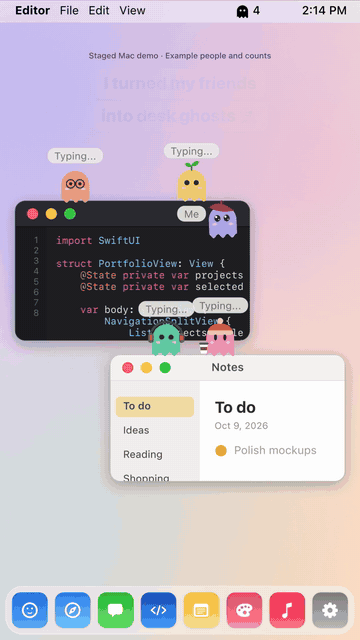

  

<h1 align="center">Poff</h1>

  <b>Your friends, as tiny ghosts on your Mac, while you each do your own work.</b> 
  No camera. No chat log. Just company.

  <a href="https://daypixel.kr/poff/en/">Website</a> ·
  <a href="../../releases/latest">Download</a> ·
  <a href="../../issues">Report a bug</a> ·
  <a href="../../discussions">Ideas &amp; feedback</a>

  
   Staged demo with example people.

## What it is

Poff is a small macOS menu bar app for people who work alone. Join a room with friends and everyone shows up on each other's desktop as a tiny ghost:

| Your friend is… | Their ghost… |
|---|---|
| typing | sits on top of the window you're actually using |
| thinking or on a break | floats around and pauses now and then |
| away | dozes in the bottom corner |

Click a ghost to **wave**, **cheer 🔥**, **pat**, or **send a coffee ☕**. Click your own ghost to send a short message (up to 80 characters) to the people in your friend room.

## Little details

- **Real windows.** Ghosts land on the top edge of real windows and skip edges hidden behind other windows.
- **Drag and shake.** Drag a window and they ride along. Shake it and they tumble off, then climb back a few seconds later.
- **Weight.** Inertia, a lean into turns, squash on landing, a wavy hem, and eyes that follow your cursor.
- **Out of your way.** Clicks pass straight through. Move slowly toward a ghost to click it; swipe past and it dodges.
- **Your own ghost.** Hover slowly to pet it. Pick it up and shake it and it gets dizzy 😵.
- **Focus mode, no timer.** After 10 minutes of steady typing, everyone calms down and goes quiet. It eases back when you take a break.

## Privacy

Poff shares your **name, task, look, status** (typing / thinking / break / away) and the **waves, reactions and messages you choose to send**.

- Your screen, window titles and window contents are never read or sent.
- The automatic "Coding" / "Designing" status comes from the *kind* of app in front, not what's inside it. App names are added only if you turn that on.
- By default you join the public **Plaza**, where other Poff users can see your ghost, name, task and status. Messages are sent only to your friend room, never to the Plaza.
- You can delete your account and data from the app menu. See the [privacy policy](https://daypixel.kr/poff/en/privacy.html).
- Presence and messages go over Supabase Realtime and are not stored as chat history. The server keeps rooms (code and name) and which rooms a device has joined.

## Requirements

- **Mac:** Apple Silicon, macOS 14 or later. Signed with Developer ID and notarized by Apple.
- **Windows:** an early x64 test build is available. It is not code-signed yet and has fewer features.

Poff is a free public beta. The app is available in English and Korean.

## Download

**[Download the latest version](../../releases/latest)**: `Poff-<version>.dmg` for Mac. Windows test builds are in the same release. You can also download from the **[website](https://daypixel.kr/poff/en/)**. The Mac app checks for updates with Sparkle and installs them when you choose.

## Open source: PerchKit

The part that decides where a ghost can sit on your windows and when a window is being shaken is open source under the MIT license: **[PerchKit](PerchKit/)**. It's plain Swift with CoreGraphics only, with tests.

## Feedback

- Found a bug? [Open an issue](../../issues/new).
- Have an idea or want to share how you use it? [Start a discussion](../../discussions).

Made by [DayPixel](https://daypixel.kr). This repository is the public home for Poff's issues, feedback and release notes. Apart from [PerchKit](PerchKit/), the app's source code is not published. The Poff name, character and artwork are not covered by the MIT license.
